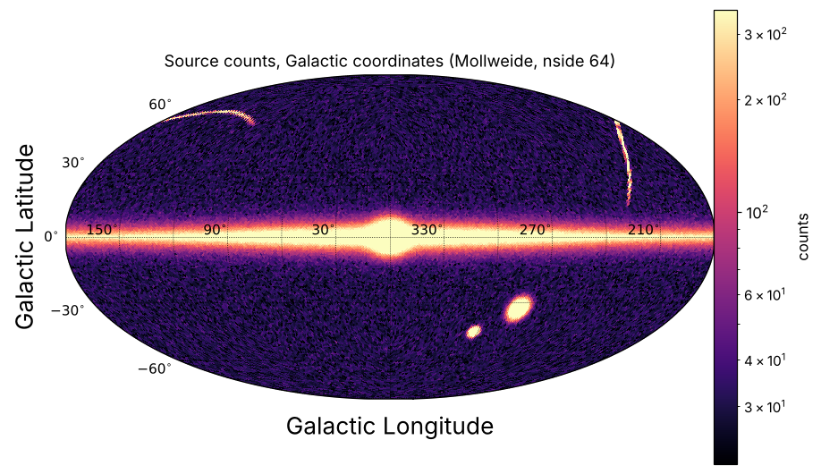

# astro-polars

Astronomy on [Polars](https://pola.rs): cross-matching, sky selections, HEALPix,
frame rotations, photometry, survey pipelines and sky maps for catalogues with
millions to billions of rows.
Everything works on lazy and streaming Polars frames, so the same code runs on a
notebook-sized table or on a partitioned survey on disk.

Documentation: https://balbinot.github.io/astro-polars/

## Install

```bash
pip install astro-polars            # core
pip install "astro-polars[viz]"     # + matplotlib and skyproj for plots
pip install "astro-polars[fits]"    # + astropy, to read FITS tables (Euclid MER)
pip install "astro-polars[all]"     # every optional feature
```

Development version:

```bash
pip install "git+https://github.com/balbinot/astro-polars"
```

Python 3.9 or newer. The core depends on polars, numpy, numba, scipy,
scikit-learn and hpgeom.

## Quick look

```python
import polars as pl
import astro_polars as ap

lf = pl.scan_parquet("gaia_dr3/*.parquet")

# selections and new columns, all lazy
sel = (
    lf.sky.cone(266.4, -28.9, radius=2.0)           # degrees
      .sky.to_galactic()                             # l, b, pml, pmb
      .sky.add_healpix(4096)                         # hpx4096, nested
      .filter(pl.col("parallax").robust.zscore().abs() < 5)
)

# cross-match two catalogues (KD-tree on unit vectors)
matches = ap.crossmatch(lf, other, radius_arcsec=1.0, how="inner")

# magnitudes and colours from fluxes, many bands at once
lf.phot.add_mags({"g": "flux_g", "r": "flux_r"}, zeropoint="nanomaggy")

# heatmaps and sky maps, binned in streaming Polars
lf.viz.heatmap("bp_rp", "phot_g_mean_mag", log=True)
lf.viz.healpix("ra", "dec", nside=128, what="mean", z="parallax")
```



More figures in the [gallery](https://balbinot.github.io/astro-polars/gallery/).

## What is in it

| Module | Contents |
|---|---|
| `astro_polars.sphere` | `angular_separation` (Vincenty, numba), `angsep` and `in_cone` expressions |
| `astro_polars.polygon` | `in_polygon` / `pinside`, parallel ray casting with numba |
| `astro_polars.crossmatch` | `crossmatch` (alias `crossmatch_polars`), `remove_duplicates` |
| `astro_polars.healpix` | `healpix_index`, `degrade`, `gaia_source_id_to_healpix`, `cone_pixels` |
| `astro_polars.coords` | rotations with proper motions and their errors: ICRS, Galactic, stream frames |
| `astro_polars.robust` | `pl.col(x).robust.nmad()`, `.robust.zscore()` |
| `astro_polars.photometry` | AB zero points, magnitudes, errors, colours, aperture corrections, extinction; `df.phot` namespace |
| `astro_polars.io` | HEALPix hive-partitioned Parquet (`write_partitions`, `scan_hive` with cone pruning, `Manifest`), FITS tables |
| `astro_polars.surveys.euclid` | Euclid MER final-catalogue pipeline: magnitudes, colours, horn and magnitude cuts, tiles to a hive dataset |
| `astro_polars.viz` | `heatmap` on grids or HEALPix, `skymap` with skyproj, `df.viz` namespace |

Euclid MER tiles to a HEALPix-partitioned Parquet dataset, restartable:

```bash
astro-polars euclid-hive --indir tiles/ --outdir mer_hive/ --nside 32
```

Planned next: HATS read and write, survey modules (Gaia DR4, 4MOST, DESI, DES,
LSST). See the [roadmap](https://balbinot.github.io/astro-polars/roadmap/).

## Licence

GPL-3.0-or-later. See [LICENSE](LICENSE).

## Acknowledgements

The idea of a Polars extension for astronomy follows Tom Callingham's
[polars_astro](https://github.com/TomCallingham/polars_astro). This package is
a separate, fresh implementation.
