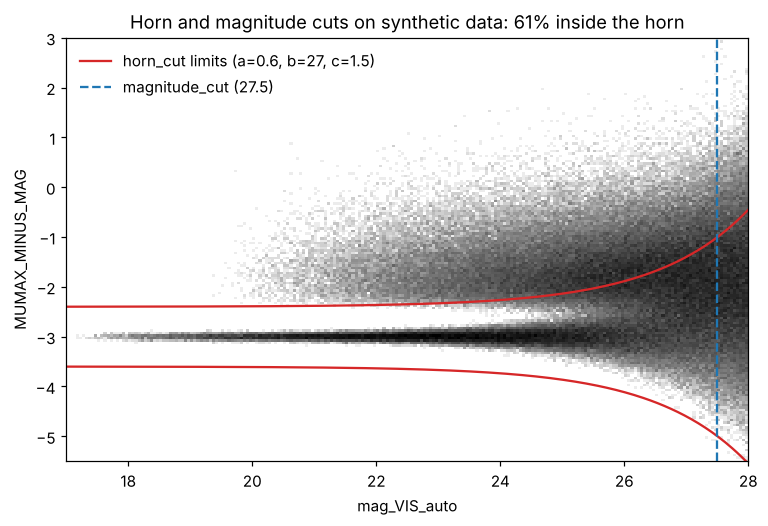

# Euclid MER catalogues

`astro_polars.surveys.euclid` turns Euclid MER final-catalogue tiles into
magnitudes, colours and a quality-cut selection, and writes
a whole download into one HEALPix-partitioned Parquet dataset.

Reading FITS needs the `fits` extra:

```bash
pip install "astro-polars[fits]"
```

## A whole download, from the shell

Tiles are expected as `INDIR/<tile>/EUC_MER_FINAL-CAT_TILE*.fits*`.

```bash
astro-polars euclid-hive --indir tiles/ --outdir mer_hive/ --nside 32
```

The output looks like

```
mer_hive/
  _manifest.json                         # converted files: size, mtime, rows, partitions
  hpx32=6809/part-102018-6809.parquet    # one file per (tile, partition)
  hpx32=6811/part-102018-6811.parquet
  hpx32=6811/part-102019-6811.parquet
```

- Re-running only converts files that are new or whose size changed. Use
  `--force` to redo everything.
- A tile that is redone first has its old partition files removed, so no
  stale rows remain.
- Each file is written to a temporary name and renamed, and the manifest is
  saved after every tile, so an interrupted run can simply be started again.
- A file that fails is reported and left out of the manifest; the run goes on.

The same from Python:

```python
from astro_polars.surveys import euclid

summary = euclid.convert_tiles("tiles/", "mer_hive/", nside=32)
# {'found': 412, 'processed': 412, 'failed': 0, 'skipped': 0, 'errors': {}}
```

## Reading the dataset

```python
import polars as pl
import astro_polars as ap
from astro_polars.io import scan_hive

lf = scan_hive("mer_hive/")                                   # everything, lazily
lf = scan_hive("mer_hive/", cone=(150.1, 2.2, 1.0))           # only partitions touching the cone
stars = (
    lf.sky.cone(150.1, 2.2, 1.0, lon="RIGHT_ASCENSION", lat="DECLINATION")
      .filter(pl.col("POINT_LIKE_PROB") > 0.9)
      .select("OBJECT_ID", "mag_VIS", "mag_Y", "VIStoH")
      .collect()
)

# sky maps from the stored fine index, without touching RA/Dec
lf.viz.healpix(nside=512, ipix="hpx4096", ipix_nside=4096, what="len")
```

`pl.scan_parquet("mer_hive/**/*.parquet", hive_partitioning=True)` works too;
`scan_hive` adds the partition pruning.

## What the pipeline adds and cuts

| Step | Function | Result |
|---|---|---|
| aperture to total | `add_aperture_corrections` | `corr1`, `corr2` = `FLUX_DETECTION_TOTAL` / VIS 1 and 2 FWHM aperture flux |
| total magnitudes | `add_mags` | `MAG_MAP`: `mag_VIS` (PSF), `mag_VIS_auto`, `mag_Y`, `mag_J`, `mag_H`, DECam, MegaCam, Pan-STARRS, HSC |
| aperture magnitudes | `add_aper_mags` | `APER_MAG_MAP`: `{band}_1fwhm`, `{band}_2fwhm`, corrected to total |
| errors | `add_magerrs` | `MAGERR_MAP`: `magerr_*` = 2.5 / ln 10 × fluxerr / flux |
| template colours | `add_visto_colors` | `VISTO_MAP`: `VIStoH`, `GtoVIS`, ... |
| clean | `clean` | drops NaN or infinite `MUMAX_MINUS_MAG` and `POINT_LIKE_PROB` |
| horn | `horn_cut(a=0.6, b=27, c=1.5)` | keeps \|MUMAX_MINUS_MAG + 3\| ≤ a + exp((mag_VIS_auto − b) / c) |
| depth | `magnitude_cut(27.5)` | `mag_VIS_auto < 27.5`, one row per `OBJECT_ID` |
| HEALPix | `add_healpix(nside, map_nside=4096)` | `hpx4096` (kept in every file) and the partition key `hpx{nside}` |



Magnitudes are AB with zero point 23.9 (MER fluxes are in µJy). Entries of the
maps whose columns are missing from a file are skipped, so the pipeline also
runs on catalogues with fewer bands.

Every step works on a DataFrame or a LazyFrame, so you can run part of the
pipeline, change the cuts or add your own step:

```python
df = euclid.read_mer("tiles/102018/EUC_MER_FINAL-CAT_TILE102018-....fits")

loose = euclid.transform(df, horn=None)                 # no horn cut
custom = euclid.transform(df.lazy(), horn=(0.8, 26.5, 1.5), mag_vis_auto_max=26.0).collect()

def my_transform(lf):
    return euclid.transform(lf).filter(pl.col("SPURIOUS_FLAG") == 0)

euclid.convert_tiles("tiles/", "mer_hive_clean/", transform_fn=my_transform)
```
