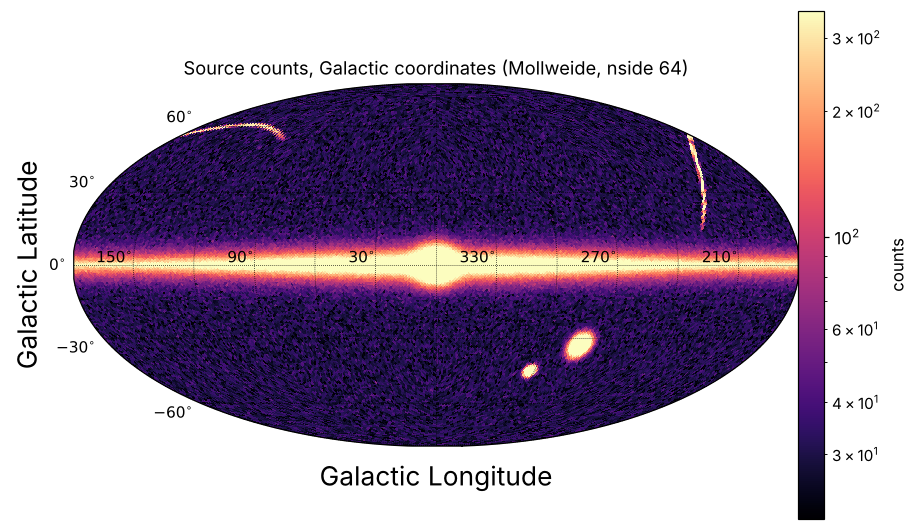
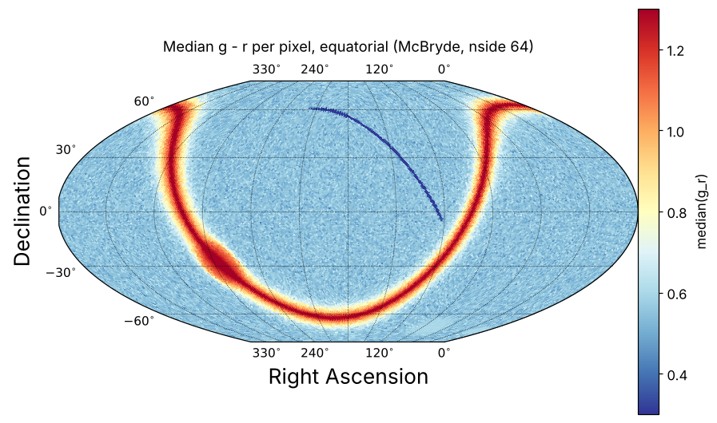
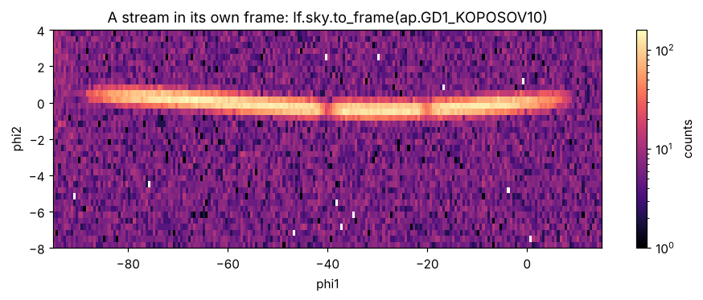
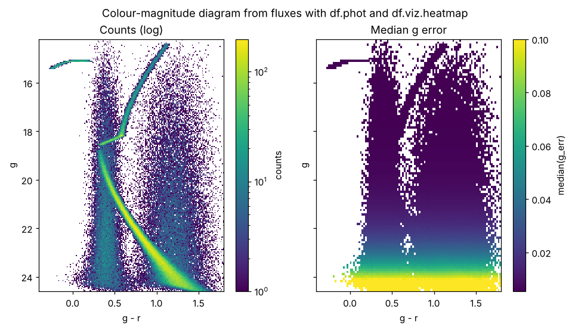
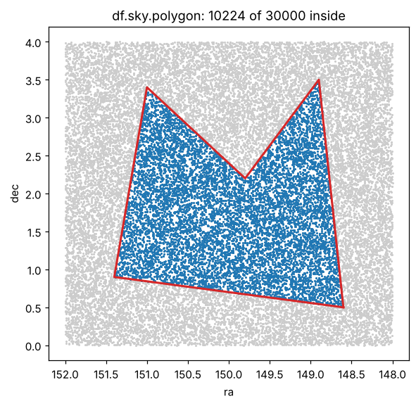
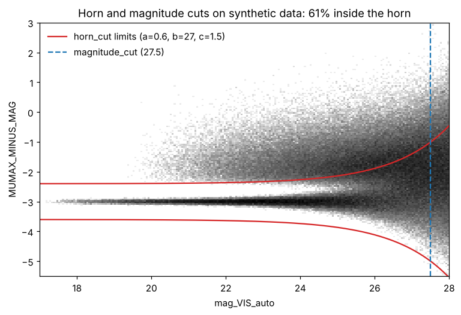

# Gallery

Figures made with astro-polars. The catalogues are synthetic (a mock sky
with a disc, bulge, halo, two satellites and a stream; a mock star cluster;
mock Euclid MER measurements), so the pictures show what the functions do,
not real data. The script that makes them is
[`docs/figures/make_figures.py`](https://github.com/balbinot/astro-polars/blob/main/docs/figures/make_figures.py).

Plots need the `viz` extra: `pip install "astro-polars[viz]"`.

```python
import numpy as np
import polars as pl
import astro_polars as ap

ap.viz.use_style()          # tab10 colour cycle
```

## Sky map of counts

Bin on HEALPix pixels (streamed through Polars) and draw with skyproj. Here
the catalogue is first rotated to Galactic coordinates.

```python
lf = sky.lazy().sky.to_galactic()
lf.viz.healpix("l", "b", nside=64, galactic=True, log=True, cmap="magma")
```



## Sky map of a statistic

Any aggregation in `ap.viz.AGGREGATIONS` (`mean`, `median`, `std`, `nmad`...)
of a column, here the median colour per pixel, on a McBryde projection.

```python
sky.lazy().viz.healpix(
    "ra", "dec", nside=64, what="median", z="g_r",
    projection="mcbryde", lon_0=180, cmap="RdYlBu_r", vmin=0.3, vmax=1.3,
)
```



## A stream in its own frame

Rotate to a great-circle frame (`ap.GD1_KOPOSOV10`, or any frame from
`ap.frame_from_pole`) and bin on a grid.

```python
lf = (
    sky.lazy()
    .sky.to_frame(ap.GD1_KOPOSOV10)            # adds phi1, phi2
    .filter(pl.col("phi2").is_between(-8, 4))
)
lf.viz.heatmap("phi1", "phi2", lims=((-95, 15), (-8, 4)), shape=(220, 36),
               log=True, cmap="magma")
```



## Colour-magnitude diagram from fluxes

Magnitudes, colours and errors from fluxes with `df.phot`, then two heatmaps:
counts, and the median magnitude error in each bin.

```python
lf = (
    cat.lazy()
    .phot.add_mags({"g": "flux_g", "r": "flux_r"}, zeropoint="nanomaggy")
    .phot.add_colors({"g_r": ("flux_g", "flux_r")})
    .phot.add_magerrs({"g_err": ("flux_g_err", "flux_g")})
)
lims = ((-0.4, 1.8), (14.2, 24.6))
lf.viz.heatmap("g_r", "g", lims=lims, shape=220, log=True, ax=ax1)
lf.viz.heatmap("g_r", "g", what="median", z="g_err", lims=lims, shape=110, ax=ax2, vmax=0.1)
ax1.invert_yaxis()
```



## Polygon selection

```python
poly = np.array([[148.6, 0.5], [151.4, 0.9], [151.0, 3.4], [149.8, 2.2], [148.9, 3.5]])
inside = df.sky.polygon(poly, x="ra", y="dec")
```



## Euclid MER cuts

The horn cut of `astro_polars.surveys.euclid` keeps sources with
`|MUMAX_MINUS_MAG + 3| <= a + exp((mag_VIS_auto - b) / c)`; the magnitude
cut keeps `mag_VIS_auto < 27.5`. See [Euclid MER](euclid.md).

```python
from astro_polars.surveys import euclid

kept = df.filter(euclid.horn_mask())          # or euclid.horn_cut(df)
df.viz.heatmap("mag_VIS_auto", "MUMAX_MINUS_MAG", lims=((17, 28), (-5.5, 3)),
               shape=(220, 170), log=True, cmap="Greys")
```


